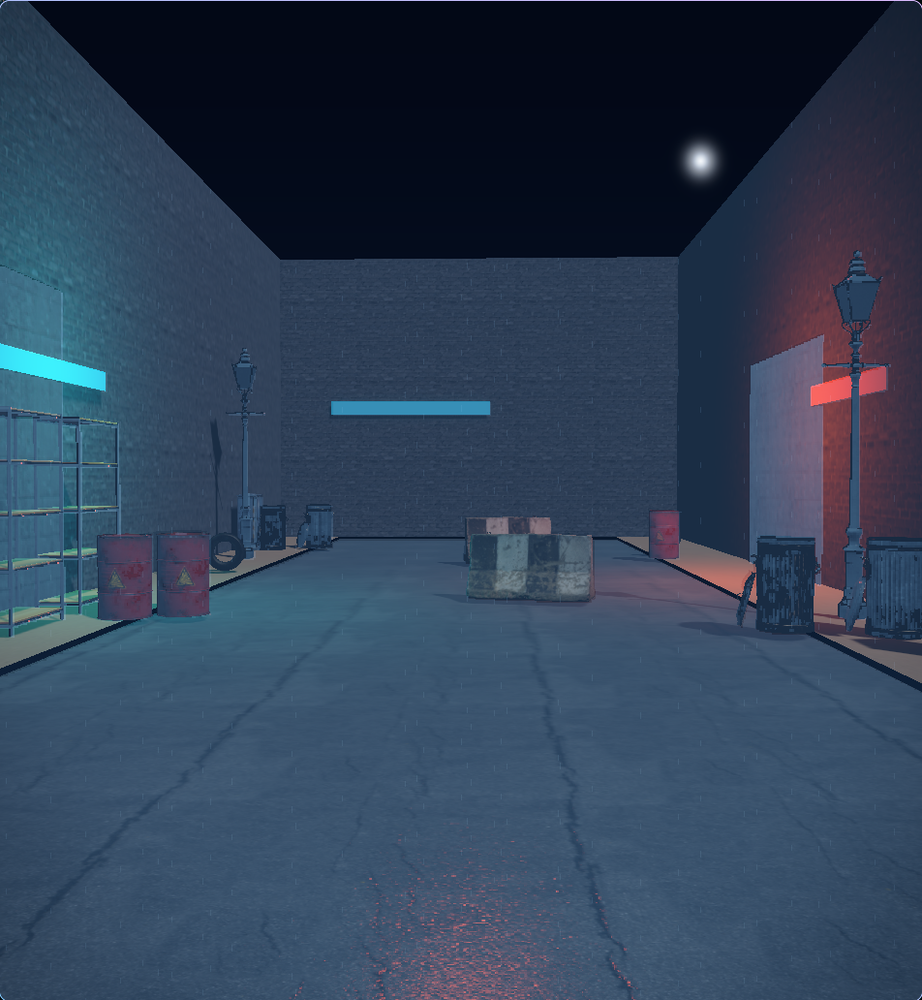

# Dhool Pro

Dhool Pro is a live vendor-agnostic GPU renderer plus a deterministic CPU reference
implementation of the architecture in [`gospol.md`](gospol.md). The live path uses
`wgpu` with standard raster and compute shaders, not hardware ray-tracing APIs or a
vendor SDK.

## Run the live GPU renderer

```sh
cargo run --release -- --live
```

The default scene is a rain-soaked industrial alley assembled from vendored Poly
Haven CC0 models and PBR surfaces. Press `Space` to pause or resume the cinematic
camera, hold `W`/`A`/`S`/`D` to move, use the arrow keys to look around, and press
`Escape` to exit. Select a present-capable adapter by name when testing multiple GPUs:

```sh
DHOOL_GPU=AMD cargo run --release -- --live
DHOOL_GPU=NVIDIA cargo run --release -- --live
```

The GPU frame executes cached directional/local shadow maps, a vertex-only
partial depth prepass, hardware depth-tested PBR+motion G-buffer rasterization,
a fullscreen R32 depth copy, half-resolution Hi-Z/fog/SSR compute passes,
temporal reflections over simplified proxy geometry, light-volume guarded HDR
deferred lighting with screen-space occlusion, world-space 3D rain with a
generated streak-detail atlas, textured puddle normals and reflection breakup,
Kawase bloom, GT tone mapping, and a final SMAA T2x-style edge/persistence
resolve. Materials use mipmapped base-color, tangent-space normal, and packed
AO/roughness/metallic maps.



The 26 MiB asset bundle is checked in for deterministic offline runs. Refresh it
from the recorded upstream manifest with:

```sh
scripts/fetch_aaa_assets.sh
```

## Run the reference frame

```sh
cargo run --release -- --dump-ppm frame.ppm
```

## Build the complete demo gallery

```sh
cargo run --release -- --gallery demo-output
python3 -m http.server 8080 -d demo-output
```

Open `http://localhost:8080`. By default the gallery exports diagnostics for
the same `assets/aaa` industrial alley scene used by `--live`: the beauty frame,
all 16 production debug views, and `timings.txt` with per-pass CPU measurements
and warnings.

Asset origins, licenses, and refresh commands are recorded in
[`ASSET_SOURCES.md`](ASSET_SOURCES.md). For the deterministic CPU glTF showcase,
pass another core glTF 2.0 asset:

```sh
cargo run --release -- --gallery demo-output --asset path/to/model.gltf
```

## Verify

```sh
cargo fmt --all -- --check
cargo clippy --all-targets -- -D warnings
cargo test --all-targets
DHOOL_GPU=AMD cargo run --release -- --live --frames 4
DHOOL_GPU=NVIDIA cargo run --release -- --live --frames 4
```

The raw analyses in `files/` directly inform the implementation: `vendor-agnostic.txt`
defines the compute-reflection direction; `crisis3.txt` and `hla.txt` inform the
depth-only prepass; `fox.txt` informs the deferred layout; `1.txt` informs contact
shadows; and `things.txt` informs the AA and GT tone mapping. CPU gallery timings remain CPU
measurements and are not directly comparable to the GPU targets in `gospol.md`.
